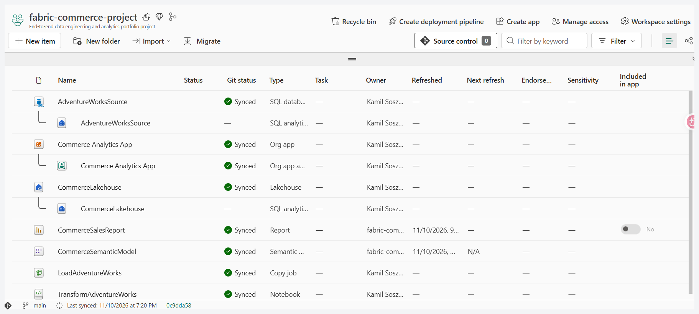
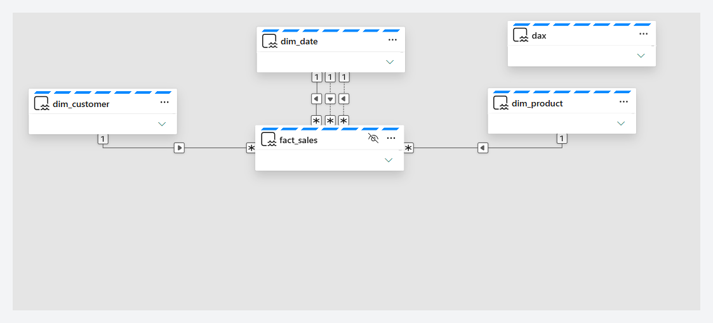
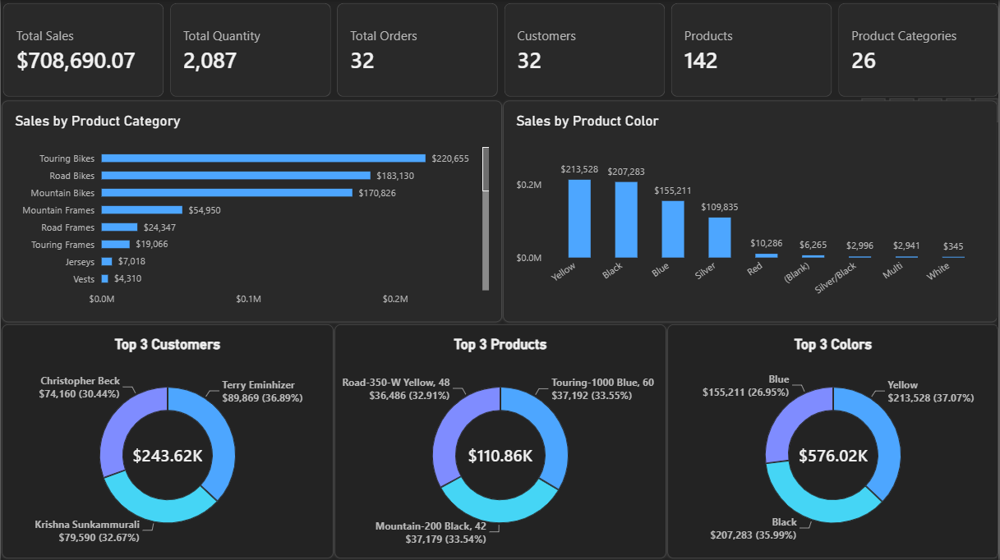

# Microsoft Fabric Commerce Analytics

An end-to-end commerce analytics solution built in Microsoft Fabric using a SQL database, Copy Job ingestion, a Lakehouse medallion architecture, PySpark transformations, a Direct Lake semantic model, Power BI, a Fabric organizational app, and Git source control.

## Solution overview

The solution ingests AdventureWorks sales data into Microsoft Fabric, transforms it through Bronze, Silver, and Gold layers, and exposes a dimensional model through Direct Lake for Power BI reporting.

### Components

- Microsoft Fabric SQL Database: `AdventureWorksSource`
- Copy Job: `LoadAdventureWorks`
- Lakehouse: `CommerceLakehouse`
- PySpark notebook: `TransformAdventureWorks`
- Semantic model: `CommerceSemanticModel`
- Power BI report: `CommerceSalesReport`
- Fabric Org App: `Commerce Analytics App`
- GitHub source control

## Microsoft Fabric workspace

The workspace contains the complete analytics solution, including the source SQL database, ingestion job, Lakehouse, transformation notebook, Direct Lake semantic model, Power BI report, and organizational app.



## Architecture

The project implements a medallion architecture:

- **Bronze:** raw AdventureWorks source tables
- **Silver:** cleaned and validated sales data
- **Gold:** dimensional star schema optimized for analytics

### Data flow

```text
AdventureWorks SQL Database
→ Fabric Copy Job
→ Bronze tables
→ PySpark transformations
→ Silver sales table
→ Gold star schema
→ Direct Lake semantic model
→ Power BI report
→ Fabric Org App
```

## Analytical model

The Gold layer contains:

- `gold.dim_customer`
- `gold.dim_product`
- `gold.dim_date`
- `gold.fact_sales`
- `gold.dax`

The semantic model includes active relationships for customers, products, and order dates, together with inactive relationships for due dates and ship dates.



## Data quality

The transformation notebook validates:

- source schemas
- required columns
- row counts
- unique sales-line identifiers
- duplicate records
- null values
- quantities, prices, and discounts
- calculated sales totals
- fact-to-dimension relationships
- Silver-to-Gold reconciliation

## Power BI report

The `CommerceSalesReport` report presents:

1. Total Sales
2. Total Orders
3. Total Quantity
4. Customer Count
5. Top Customers
6. Top Products
7. Sales by Product Color



## Repository structure

```text
.
├── AdventureWorksSource.SQLDatabase/
├── Commerce Analytics App.OrgApp/
├── CommerceLakehouse.Lakehouse/
├── CommerceSalesReport.Report/
├── CommerceSemanticModel.SemanticModel/
├── LoadAdventureWorks.CopyJob/
├── TransformAdventureWorks.Notebook/
├── docs/
│   └── images/
│       ├── 01-power-bi-report-key-insights.png
│       ├── 02-direct-lake-semantic-model.png
│       └── 03-fabric-workspace-overview.png
├── LICENSE
└── README.md
```

## Reproduce the project

1. Create or restore the AdventureWorks source database in Microsoft Fabric.
2. Run `LoadAdventureWorks` to ingest the source tables into the Bronze layer.
3. Run `TransformAdventureWorks` to create and validate the Silver and Gold layers.
4. Open `CommerceSemanticModel` and verify the Direct Lake relationships.
5. Open `CommerceSalesReport` and verify the report visuals and measures.
6. Publish the report through `Commerce Analytics App`.

## Validation results

- Bronze, Silver, and Gold layers created successfully
- data-quality checks implemented in the transformation notebook
- fact-to-dimension relationships validated
- Silver-to-Gold reconciliation implemented
- Direct Lake semantic model connected
- Power BI report created
- Fabric workspace synchronized with GitHub

## Skills demonstrated

Microsoft Fabric, SQL Database, Copy Job, Lakehouse, medallion architecture, PySpark, Delta tables, dimensional modeling, Direct Lake, DAX, Power BI, data-quality validation, and Git source control.

## License

This project is licensed under the terms specified in the [LICENSE](LICENSE) file.
