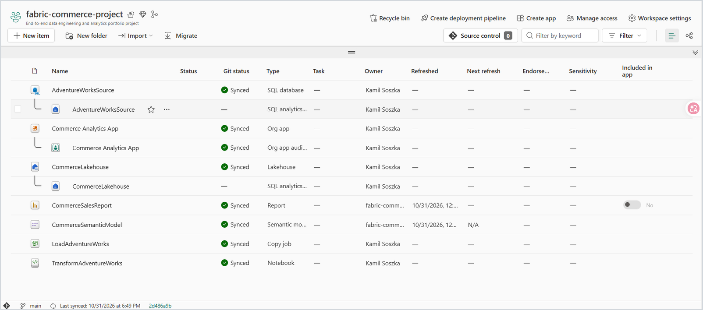

## Microsoft Fabric Workspace

The workspace contains the complete analytics solution, including the source SQL database, ingestion job, Lakehouse, transformation notebook, Direct Lake semantic model, Power BI report, and organizational app.

## Architecture

The project implements a medallion architecture:

- Bronze: raw AdventureWorks source tables
- Silver: cleaned and validated sales data
- Gold: dimensional star schema for analytics

## Data Flow

AdventureWorks SQL Database  
→ Fabric Copy Job  
→ Bronze tables  
→ PySpark transformations  
→ Silver sales table  
→ Gold star schema  
→ Direct Lake semantic model  
→ Power BI report  
→ Fabric Org App

## Components

- Microsoft Fabric SQL Database
- Fabric Copy Job
- Fabric Lakehouse
- PySpark Notebook
- Delta tables
- Direct Lake semantic model
- DAX measures
- Power BI report
- Fabric Org App
- GitHub source control

## Analytical Model

The Gold layer contains:

- `gold.dim_customer`
- `gold.dim_product`
- `gold.dim_date`
- `gold.fact_sales`
- `gold.dax`

The semantic model includes active relationships for customers, products, and order dates, together with inactive relationships for due dates and ship dates.

## Data Quality

The notebook validates:

- source schemas
- required columns
- row counts
- unique sales-line identifiers
- duplicate records
- null values
- quantities, prices, and discounts
- calculated sales totals
- fact-to-dimension relationships
- Silver-to-Gold reconciliation

## Report

The `CommerceSalesReport` report presents:

- total sales
- total orders
- total quantity
- customer count
- top customers
- top products
- sales by product color

## Repository Structure

Fabric-generated folders contain the source definitions for the SQL database, Lakehouse, Copy Job, notebook, semantic model, report, and Org App.

## License

This project is licensed under the terms specified in the [LICENSE](LICENSE) file.
